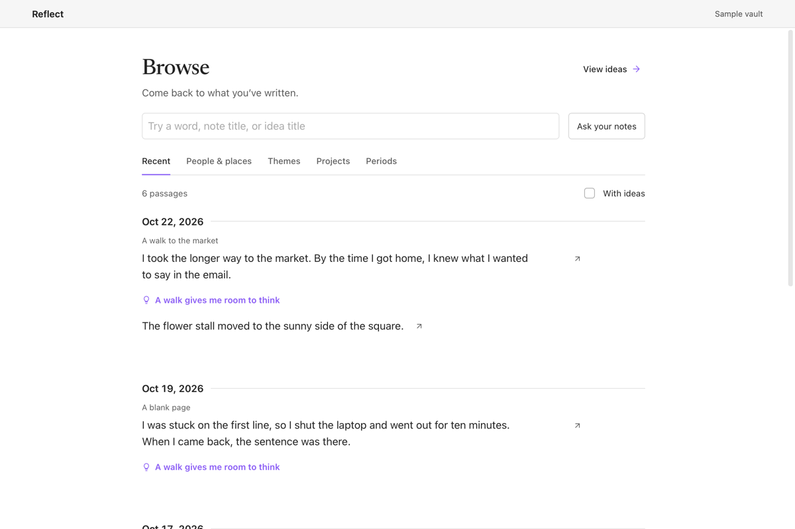
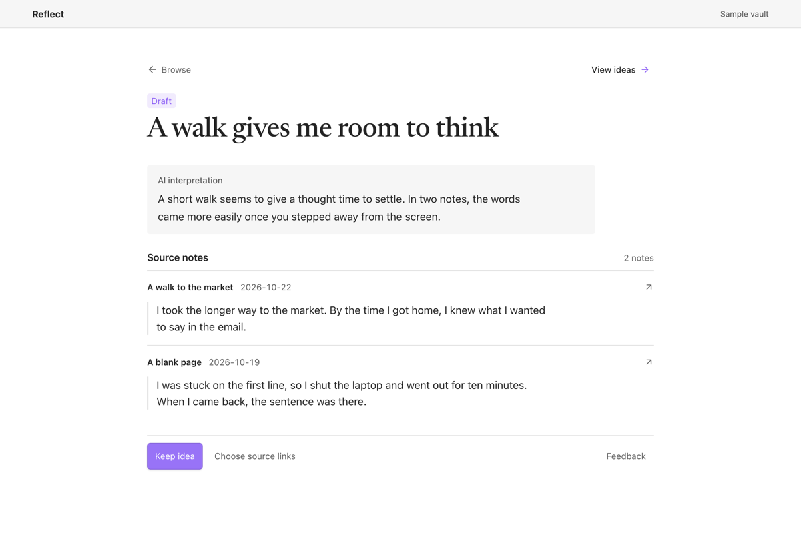

# Reflect

Reflect is an Obsidian plugin for coming back to what you’ve written. It brings related passages together so you can see which ideas keep coming up. Each passage links back to the note it came from.

**Pre-alpha.** I’m still exploring how Reflect can help you come back to your notes. The workflow may change as I learn what people find useful.

## See Reflect in use

**Browse passages.** Revisit your notes by date and follow an idea that shows up in more than one passage.

**Read and keep an idea.** Read the interpretation alongside the original passages. Keep the idea as a note if you want to come back to it.

## Install

Reflect requires Obsidian Desktop 1.15.0 or later. Browse, Ideas, and keeping an idea work without model setup.

For a manual install, download `main.js`, `manifest.json`, and `styles.css` from the [latest release](https://github.com/faradayfury/reflect/releases/latest). Put them in your vault's `.obsidian/plugins/reflect` folder. Restart Obsidian, open **Settings → Community plugins**, and enable **Reflect**.

## Use Reflect

- Open **Reflect** to see recent passages in **Browse**. You can also browse by date, people and places, themes, or projects without setting up a model.
- Select **Find ideas in my notes** to look for recurring ideas. Choose a model, review the notes included in the run, and enter any folders you want to skip before selecting **Run scan**. Reflect opens the first idea alongside the passages it found.
- Open **Ideas** to read drafts and kept ideas. **Keep idea** saves a Markdown note with links to its sources. To add links back from the source notes, select **Choose source links** before keeping the idea.
- Choose **Reflect on this note** in a note’s menu or the command palette. Select **Find related ideas**, read the quoted passages, and choose **Add source** if the note adds something to an idea.
- Select **Look for more ideas** from **Ideas** to find new drafts or more sources for ideas you already have.
- **Ask your notes** to explore a question across your vault and save the findings with their original passages.

## Set up the models

Open **Find ideas in my notes**, **Look for more ideas**, or **Ask your notes** and choose a model. **Trust and test** sends a sample sentence to check the connection. **Trust and use this model** approves the connection on this device. After upgrading from an older release, choose your connection again.

| Connection | What you need |
| --- | --- |
| **Codex CLI** | Install and sign in to Codex yourself with `codex login`. Enter a model your account can access and the full path to your installed executable. Use `command -v codex` on macOS or Linux, or `(Get-Command codex.exe).Source` in PowerShell if you installed the native Windows executable. Approve the executable again after it changes. [Codex CLI setup](https://learn.chatgpt.com/docs/codex/cli) |
| **Ollama** | Start Ollama and enter a downloaded model ID from `ollama list`. Use the server URL shown by your Ollama setup. [Download Ollama](https://ollama.com/download) |
| **LM Studio** | Start the LM Studio server and enter a model ID. The preset uses port `1234`. [LM Studio server setup](https://lmstudio.ai/docs/developer/openai-compat) |
| **OpenRouter** | Choose an OpenRouter API key and enter the full model ID. [OpenRouter setup](https://openrouter.ai/docs/quickstart) |
| **Claude API** | Choose a Claude Console API key and enter the model ID. [Claude API setup](https://platform.claude.com/docs/en/api/overview) |
| **OpenAI-compatible endpoint** | Enter a base URL for a server that accepts `/chat/completions`, a model ID, and a key if required. For the OpenAI API, use `https://api.openai.com/v1`. |

Hosted models require an account or API key and may incur charges. Reflect uses Obsidian's secret storage for API keys and saves the selected connection on this device.

For **Find related ideas** and local feedback rechecks, start Ollama, run `ollama pull qwen3:4b`, and approve its exact loopback URL in **Settings → Reflect**. The default is `http://127.0.0.1:11434`. Plain HTTP works for these manual actions. Use it with a server you control because HTTP cannot verify which local process answers.

Background suggestions are off by default. To enable them, use an HTTPS loopback endpoint for your Ollama server and enter its SHA-256 certificate fingerprint from your own server configuration. Reflect checks that fingerprint before sending excerpts.

## Data and privacy

Reflect reads Markdown and keeps its review data in your vault. It updates notes when you choose to keep an idea, add a source, or save a link.

- **Local review.** Manual matches and feedback rechecks send excerpts, relevant idea summaries, and review preferences to the approved Ollama endpoint. Background review, if enabled, sends selected excerpts and review context to the verified endpoint.
- **Scans and questions.** Reflect shows the destination and included notes before sending note bodies, titles, dates, and selected source passages. Daily notes can be included. Reflect skips symbolic links and files with multiple hard links. Questions go to the selected model with that material. Saved review preferences and draft interpretations stay out of these requests.
- **Codex CLI.** Reflect launches the approved program outside the vault. It uses a temporary directory for the CLI response and removes it after the process exits. It requests OpenAI as the provider and uses the default Codex sign-in on this device. Reflect asks the CLI to disable agent tools and use a read-only sandbox. Managed Codex policies still apply.

## Prepare a release

From the reviewed commit, push a version tag that exactly matches `manifest.json`. GitHub Actions runs the tests, attests the three install files, and uploads those same files to a draft release. Review the draft and run the Obsidian directory preview scan before publishing.

## License

Reflect is licensed under the [MIT License](LICENSE). The bundled Newsreader typeface is licensed separately under the [SIL Open Font License](Newsreader-OFL.txt).
